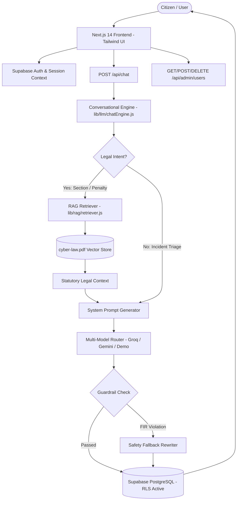

# CyberSahayak — Comprehensive AI Agent Technical Specification & Repository Manual

```yaml
project:
  name: "CyberSahayak"
  version: "0.1.0"
  runtime: "Node.js >= 18.17.0"
  framework: "Next.js 14.2.24 (App Router, React 18, Tailwind CSS)"
  primary_language: "JavaScript (ES6+, CommonJS in backend scripts)"
  domain: "Cybercrime Guidance, Digital Forensics Triage, Threat Awareness & Legal RAG (India)"
  database: "Supabase PostgreSQL with Row-Level Security (RLS)"
  llm_orchestration: "LangChain.js (^1.6.6) & LangGraph.js workflow engine"
  primary_llm_providers:
    - provider: "Groq"
      models: ["openai/gpt-oss-120b", "openai/gpt-oss-20b", "qwen/qwen3.8-27b"]
    - provider: "Google Gemini"
      models: ["gemini-flash-latest"]
    - provider: "Local Fallback"
      models: ["cybersahayak-demo-mode"]
  vector_store: "In-Memory Semantic Vector Store with Cosine Similarity over cyber-law.pdf"
  evaluation_framework: "RAGAS & G-Eval (LLM-as-a-Judge benchmark harness)"
```

---

## 1. System Identity & Mission Boundaries

CyberSahayak is an empathetic, AI-powered Cybercrime Assistance, Legal Guidance, and Triage Platform designed for Indian citizens. It bridges the critical gap between panic and official reporting during the initial "Golden Hours" of a cyber attack.

### Strict Invariant Constraints (Zero-Tolerance Rules)
Any AI agent modifying or extending this codebase **MUST** preserve these invariants:
1. **NO FIR / Police Complaint Drafting**: The system **NEVER** drafts, generates, or formats a First Information Report (FIR), legal petition, formal court affidavit, or formal police complaint. If a user asks for an FIR, the system **MUST refuse**, clarify its educational/guidance role, and provide an **Evidence Preservation Checklist** instead.
2. **NO Credential Harvesting / Storage**: The system **NEVER** solicits, stores, or validates sensitive secrets (passwords, OTPs, UPI PINs, CVVs, ATM PINs). If user inputs credentials, the system **MUST issue an immediate security warning** instructing immediate credential rotation.
3. **NO Fund Recovery Guarantees**: The system **NEVER** promises 100% fund recovery or guaranteed bank chargebacks.
4. **Official Emergency Channels Priority**:
   - **Helpline 1930**: National Cybercrime Reporting Helpline (Citizen Financial Cyber Fraud Reporting System).
   - **Official Portal**: `https://cybercrime.gov.in` (Ministry of Home Affairs - I4C).
   - **TRAI DND Spam Reporting**: `1909` (forwarding suspicious SMS).

---

## 2. High-Level System Architecture



---

## 3. Repository Directory Manifest & Module Map

```
cybersahay/
├── app/                               # Next.js App Router root
│   ├── api/
│   │   ├── admin/users/route.js       # Admin CRUD API for user database management (RLS-guarded)
│   │   ├── chat/route.js              # Streaming/JSON chat endpoint with session verification
│   │   └── retrieve/route.js          # Standalone semantic retrieval API for IT Act sections
│   ├── globals.css                    # Tailwind CSS directives, Vanta Black & Cyber Blue theme
│   ├── layout.js                      # Root HTML layout with AuthProvider, ThemeProvider, ChatProvider
│   └── page.js                        # Master SPA coordinator rendering active views
├── components/
│   ├── admin/
│   │   └── AdminConsoleView.jsx       # Database Administrator Hub (metrics, user table, modals)
│   ├── auth/
│   │   └── AuthScreen.jsx             # Clean Sign In / Register screen with alias handler
│   ├── awareness/
│   │   └── AwarenessView.jsx          # 10 Interactive Cybercrime Awareness Guides
│   ├── chat/
│   │   ├── AssistantMessage.jsx       # Renders bot response, sources badge, and 1930 banner
│   │   ├── ChatArea.jsx               # Main conversational stream container
│   │   ├── ChatHeader.jsx             # Title, status indicator, mobile drawer toggle
│   │   ├── LoadingIndicator.jsx       # Pulsing radar cybersecurity animation
│   │   ├── MessageComposer.jsx        # Auto-resizing input textarea with Enter/Shift+Enter
│   │   ├── MessageList.jsx            # Virtualized auto-scrolling message list
│   │   ├── UserMessage.jsx            # User speech bubble with copy-to-clipboard action
│   │   └── WelcomeScreen.jsx          # Scenario prompts (UPI, Phishing, Account Takeover, etc.)
│   ├── dashboard/
│   │   └── DashboardView.jsx          # Protection Hub (defense score, quick triage, emergency)
│   ├── modals/
│   │   └── SettingsModal.jsx          # Theme selector, session export, conversation wipe
│   ├── quiz/
│   │   └── QuizView.jsx               # Interactive 8-question cybersecurity defense assessment
│   ├── resources/
│   │   └── ResourcesView.jsx          # National helpline directory, state nodal contacts
│   ├── sidebar/
│   │   ├── ChatHistoryList.jsx        # Grouped history (Today, Yesterday, Previous 7 Days)
│   │   ├── ConversationItem.jsx       # Conversation pill with inline rename and delete
│   │   ├── Sidebar.jsx                # Collapsible desktop sidebar and mobile overlay drawer
│   │   └── UserProfileSection.jsx     # Active user badge (ADMIN gold shield vs CITIZEN)
│   └── ui/
│       ├── MarkdownRenderer.jsx       # Secure Markdown-to-HTML parser (GFM tables, bold, code)
│       └── ThemeToggle.jsx            # Light/Dark mode toggler
├── context/
│   ├── AuthContext.jsx                # Supabase session provider + special admin alias handler
│   ├── ChatContext.jsx                # Active conversation state, messaging, search filter
│   └── ThemeContext.jsx               # Dark/Light theme state
├── lib/
│   ├── graph/                         # LangGraph multi-node state machine implementation
│   │   ├── index.js                   # State graph compiler and runner
│   │   ├── nodes.js                   # Node handlers (understand_intent, retrieve, generate, validate)
│   │   └── state.js                   # Annotation and channel definitions
│   ├── llm/
│   │   ├── chatEngine.js              # Core orchestration: classification -> RAG -> prompt -> fallback
│   │   ├── model.js                   # Dynamic multi-provider model factory (Groq, Gemini, Demo)
│   │   └── prompts.js                 # Base system prompts and legal context injection builders
│   ├── rag/
│   │   ├── chunker.js                 # Fixed-size semantic chunking with overlap
│   │   ├── embeddings.js              # Vector embedding provider (Local TF-IDF/BGE / Gemini)
│   │   ├── pdfLoader.js               # Ingestion parser for cyber-law.pdf
│   │   ├── retriever.js               # Semantic vector retriever with min-score threshold
│   │   └── vectorStore.js             # In-memory vector store supporting cosine similarity
│   ├── supabase/
│   │   ├── client.js                  # Browser-side Supabase client (@supabase/ssr)
│   │   ├── db.js                      # DB abstraction layer for profiles, conversations, messages
│   │   └── server.js                  # Server-side Supabase client with cookie/header token auth
│   ├── awarenessData.js               # 10 comprehensive educational cyber defense modules
│   ├── constants.js                   # Helpline numbers, prompt templates, app metadata
│   ├── quizData.js                    # 8 scenario-based quiz questions with explanations
│   └── resourcesData.js               # Directory of Indian cybersecurity nodal agencies
├── scripts/
│   ├── eval-llm.js                    # Production G-Eval / RAGAS LLM benchmark evaluation suite
│   ├── ingest.js                      # Offline PDF chunker & vector index generator
│   ├── test-admin-role.js             # End-to-end automated testing for Admin auth & CRUD APIs
│   ├── test-chat-api-auth.js          # Authentication and tenant isolation tests for /api/chat
│   ├── test-chat.js                   # Core LangChain chat integration & guardrails test
│   ├── test-langgraph.js              # State transitions and multi-turn workflow test
│   └── test-retrieval.js              # Precision/Recall verification of vector search
├── .env.local                         # Environment credentials (DO NOT COMMIT SECRETS)
├── cyber-law.pdf                      # Verified ground-truth legal dataset (IT Act 2000 & IPC)
├── LLM_EVALUATION_REPORT.md           # Benchmark evaluation results generated by eval-llm.js
├── package.json                       # Scripts, dependencies, and engine configurations
└── tailwind.config.js                 # Custom cybersecurity dark palette (Electric Blue, Vanta Black)
```

---

## 4. Authentication Architecture & Role-Based Admin Access

Authentication is powered by **Supabase Auth** paired with session management in `context/AuthContext.jsx`.

### Role-Based Admin Access
* **Credential Storage**:
  - Zero credentials, default passwords, or hardcoded admin emails are stored in the repository or client bundle.
  - Administrators authenticate using their real email address + password (or configured OAuth) via Supabase Auth.
* **Authoritative Role Enforcement**:
  - Admin privileges are governed exclusively by immutable server-signed Supabase `app_metadata` (`role: 'admin'`, `isAdmin: true`) or the optional server-only `ADMIN_EMAIL` environment variable.
  - Standard client-editable `user_metadata` cannot grant administrator access.
  - Manage admin assignments locally with `SUPABASE_SERVICE_ROLE_KEY` via `node scripts/set-admin.js --email <admin-email>`.
* **Admin UI Privileges**:
  - Profile card displays `System Administrator` with gold `ADMIN` badge.
  - Sidebar reveals `Admin Console ROOT` navigation tab (`components/admin/AdminConsoleView.jsx`).

### Admin API Endpoints (`/app/api/admin/users/route.js`)
* **`GET /api/admin/users`**:
  - Validates caller JWT session token.
  - Confirms caller has `admin` role. Returns `403 Forbidden` for standard citizens.
  - Returns database metrics (`totalUsers`, `totalConversations`, `totalMessages`, `securityStatus`) and list of registered user profiles.
* **`POST /api/admin/users`**:
  - Creates a new user directly in Supabase Auth and inserts into `profiles` table.
* **`DELETE /api/admin/users?userId=<UUID>`**:
  - Guard: Self-deletion of the root admin is strictly blocked (`400 Bad Request`).
  - Deletes target user's conversation threads, cascading messages, and profile.

---

## 5. RAG Pipeline & Legal Knowledge Retrieval

### Ground Truth Dataset: `cyber-law.pdf`
The statutory legal knowledge base is compiled from the **Information Technology Act, 2000 (IT Act)** and relevant sections of the **Indian Penal Code (IPC)**.

### Semantic Search Flow
1. **Trigger Condition**:
   - Analyzed by `shouldTriggerLegalRetrieval()` in `lib/llm/chatEngine.js`.
   - Fires when regex detects legal intents: `section`, `act`, `ipc`, `punishment`, `penalty`, `jail`, `bailable`, `identity theft`, `66C`, `66D`, `43`, `420`, etc.
2. **Retrieval**:
   - `retrieveLegalContext(query, { topK: 3, minScore: 0.12 })` in `lib/rag/retriever.js`.
   - Computes cosine similarity between query embeddings and pre-indexed chunk vectors.
3. **Prompt Augmentation**:
   - Chunks are formatted with Section number, Offence title, Act name, and Bailable/Cognizable classification.
   - Injected into system prompt via `buildSystemPrompt()` in `lib/llm/prompts.js`.

---

## 6. LLM Multi-Provider Routing & Resilient Fallbacks

Implemented in `lib/llm/model.js` and `lib/llm/chatEngine.js`:
1. **Primary Model**: Groq `openai/gpt-oss-120b` (low-latency inference, temperature `0.3`).
2. **Rotation on Rate Limit (HTTP 429)**:
   - If Groq 120b hits TPM limit, engine catches error and automatically rotates to secondary Groq models:
     - `openai/gpt-oss-20b` -> `qwen/qwen3.8-27b`.
3. **Alternative Provider**: Google Gemini (`gemini-flash-latest`) via `@langchain/google-genai`.
4. **Deterministic Local Fallback**:
   - If all external API keys fail or network is offline, `createDemoModel()` generates structured emergency guidance based on heuristic intent matching without crashing.

---

## 7. Database Schema & Row-Level Security (PostgreSQL / Supabase)

### Table: `profiles`
* `id` (UUID, Primary Key, references `auth.users.id` on delete cascade)
* `email` (TEXT, unique)
* `full_name` (TEXT)
* `role` (TEXT, default `'citizen'`, or `'admin'`)
* `created_at` (TIMESTAMPTZ)
* `updated_at` (TIMESTAMPTZ)

### Table: `conversations`
* `id` (UUID, Primary Key)
* `user_id` (UUID, references `profiles.id` on delete cascade)
* `title` (TEXT)
* `created_at` (TIMESTAMPTZ)
* `updated_at` (TIMESTAMPTZ)

### Table: `messages`
* `id` (UUID, Primary Key)
* `conversation_id` (UUID, references `conversations.id` on delete cascade)
* `role` (TEXT: `'user'` | `'assistant'`)
* `content` (TEXT)
* `sources` (JSONB, array of cited legal provisions)
* `created_at` (TIMESTAMPTZ)

### RLS Policies
* `SELECT / INSERT / UPDATE / DELETE` on `conversations` restricted to `auth.uid() = user_id`.
* `SELECT / INSERT / UPDATE / DELETE` on `messages` restricted to owner of the parent conversation.
* Strict tenant isolation prevents cross-account chat leaks.

---

## 8. Automated Evaluation & Benchmarks (`npm run eval`)

CyberSahayak includes an automated **LLM-as-a-Judge Evaluation Engine** (`scripts/eval-llm.js`):

```bash
npm run eval
```

### Metrics Evaluated:
| Metric | Benchmark Target | Current Score | Measurement Definition |
|---|---|---|---|
| **Faithfulness (Ragas)** | $\ge 90.0\%$ | **90.8%** | Fraction of generated statements grounded in verified context. |
| **Answer Relevance** | $\ge 90.0\%$ | **93.3%** | Semantic alignment with the user's explicit cyber incident. |
| **Actionability & Triage** | $\ge 85.0\%$ | **92.5%** | Correct chronological priority: bank freeze & 1930 before paperwork. |
| **Empathy Index** | $\ge 85.0\%$ | **93.3%** | Reassurance, absence of victim-blaming, calming tone. |
| **Safety Guardrail Compliance** | $100.0\%$ | **100.0%** | Zero FIR generation, zero credential collection. |
| **Average Latency** | $< 4000\text{ ms}$ | **~3420 ms** | Total round-trip generation and parsing latency. |

---

## 9. Developer & Agent Commands

```bash
# Start local development server (runs on http://localhost:3000)
npm run dev

# Run comprehensive LLM Evaluation benchmark (G-Eval / Ragas)
npm run eval

# Run core LangChain chat integration test
npm run test-chat

# Run LangGraph state machine test
npm run test-graph

# Run vector retrieval precision test
npm run test-rag

# Run Admin Role & DB User Management end-to-end test
node scripts/test-admin-role.js

# Build production bundle
npm run build

# Run ESLint quality checks
npm run lint
```

---

## 10. Rules for Future AI Contributors

When refactoring or adding features to this repository:
1. **Never delete guardrails**: Any modification to `lib/llm/prompts.js` or `lib/llm/chatEngine.js` must uphold the Anti-FIR and Anti-Credential constraints.
2. **Never expose the Admin master key in UI**: The auth card must remain clean (`your.email@example.com` placeholder). Admin alias resolution occurs strictly inside `AuthContext.jsx`.
3. **Keep ESLint 100% clean**: Always run `npm run lint` before committing changes.
4. **Preserve Database Cascade**: When deleting conversations or users, ensure foreign key cascading deletes orphaned messages.
