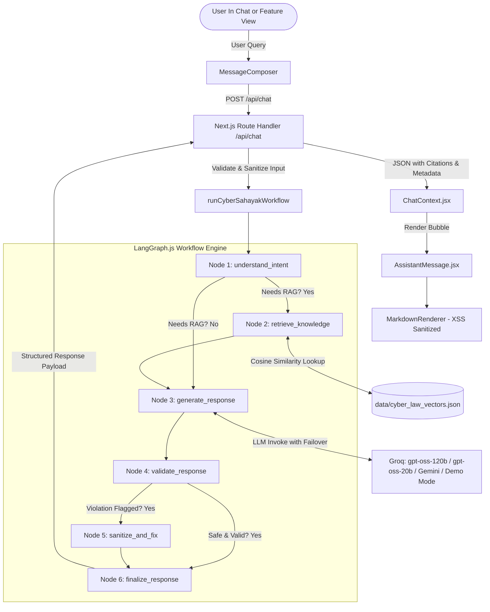
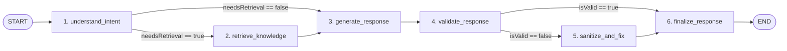
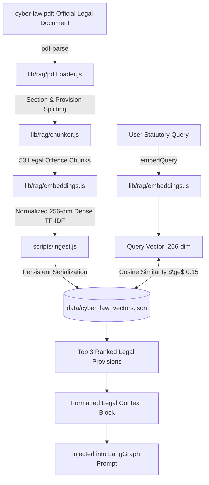

# CyberSahayak — Final Verification & Architecture Report (Stage 8)

> **CyberSahayak** is an AI-powered cybercrime assistance, digital safety, and awareness platform designed specifically for citizens in India. It is strictly an educational guidance and emergency triage tool — not an official government portal, police complaint portal, or FIR drafting tool.

---

## 1. Complete Project Structure

```plaintext
cybersahayak/
├── app/                                # Next.js 14 App Router Directory
│   ├── api/
│   │   ├── chat/
│   │   │   └── route.js                # POST /api/chat — LangGraph.js execution endpoint
│   │   └── retrieve/
│   │       └── route.js                # POST /api/retrieve — Semantic RAG retrieval endpoint
│   ├── globals.css                     # Tailwind CSS & Vanta Black/Electric Blue glow styling
│   ├── layout.js                       # Root HTML layout & Context Providers wrapper
│   └── page.js                         # Main dynamic single-page view router (Chat/Dashboard/Awareness/Quiz/Resources)
├── components/                         # Modular React 18 UI Components
│   ├── awareness/
│   │   └── AwarenessView.jsx           # 10 comprehensive cyber safety guides with deep-link AI queries
│   ├── chat/
│   │   ├── AssistantMessage.jsx        # Memoized assistant bubble with RAG citations accordion & copy action
│   │   ├── ChatArea.jsx                # Primary chat workspace container
│   │   ├── ChatHeader.jsx              # Responsive top bar with theme toggle, search status & clear action
│   │   ├── LoadingIndicator.jsx        # Pulsing multi-node AI status spinner
│   │   ├── MessageComposer.jsx         # Auto-resizing textarea with keyboard shortcuts & send button
│   │   ├── MessageList.jsx             # Auto-scrolling, virtualized message thread container
│   │   ├── UserMessage.jsx             # Memoized user message bubble with copy action
│   │   └── WelcomeScreen.jsx           # Initial onboarding hero with 4 category prompt cards
│   ├── dashboard/
│   │   └── DashboardView.jsx           # Protection Hub: stats, urgent alert banner, awareness & quiz cards
│   ├── layout/
│   │   └── ViewHeader.jsx              # Unified sticky header across dashboard, awareness, quiz, & resources
│   ├── modals/
│   │   └── SettingsModal.jsx           # Preferences modal: profile name, primary bank, emergency contacts, tone
│   ├── quiz/
│   │   └── QuizView.jsx                # 8-question scenario quiz with instant feedback, scoring & certificate
│   ├── resources/
│   │   └── ResourcesView.jsx           # Golden Hour protocol, verified portals, helpline 1930 & evidence checklist
│   ├── sidebar/
│   │   ├── ChatHistoryList.jsx         # Chronological list of conversations with search filter
│   │   ├── ConversationItem.jsx        # Rename inline, delete confirmation, and active indicator
│   │   ├── Sidebar.jsx                 # Collapsible desktop sidebar & mobile slide-out navigation drawer
│   │   └── UserProfileSection.jsx      # Footer profile badge with quick access to settings modal
│   └── ui/
│       ├── MarkdownRenderer.jsx        # Zero-dependency safe Markdown parser with strict protocol sanitization
│       └── ThemeToggle.jsx             # Vanta Dark / Clean Light mode switch
├── context/
│   ├── ChatContext.jsx                 # Central state manager (conversations, active view, quiz stats, profile)
│   └── ThemeContext.jsx                # Light / Dark theme persistence with system-preference detection
├── data/
│   └── cyber_law_vectors.json          # Pre-computed 53 vector embeddings from cyber-law.pdf provisions
├── lib/                                # Core Business Logic & Data Stores
│   ├── graph/                          # LangGraph.js Conversational State Graph
│   │   ├── index.js                    # Orchestrator & entry point: runCyberSahayakWorkflow
│   │   ├── state.js                    # StateGraph channel schema definition
│   │   ├── workflow.js                 # 6-node state graph definition & conditional routing logic
│   │   └── nodes/
│   │       ├── finalizeResponse.js     # Node 6: records clarifications, appends AIMessage, sets timestamp
│   │       ├── generateResponse.js     # Node 3: builds dynamic context prompt & invokes LLM with failover
│   │       ├── retrieveKnowledge.js    # Node 2: queries local vector store for top-k legal provisions
│   │       ├── sanitizeAndFix.js       # Node 5: safety scrubber (removes accidental FIR drafts or credential requests)
│   │       ├── understandIntent.js     # Node 1: intent classifier & urgency evaluator (decides RAG routing)
│   │       └── validateResponse.js     # Node 4: guardrail checks (FIR prohibition, no-credential harvesting, 1-question rule)
│   ├── llm/
│   │   ├── chatEngine.js               # Multi-turn conversation engine with failover model rotation
│   │   ├── model.js                    # LLM factory supporting Groq (openai/gpt-oss-120b, 20b, qwen) & Google Gemini
│   │   └── prompts.js                  # Master empathetic system prompt & guardrail definitions
│   ├── rag/                            # Retrieval-Augmented Generation Pipeline
│   │   ├── chunker.js                  # Provision-based PDF text parser & metadata extractor
│   │   ├── embeddings.js               # Local TF-IDF 256-dim embedding engine (fallback to Gemini/OpenAI)
│   │   ├── pdfLoader.js                # PDF text extraction utility via pdf-parse
│   │   ├── retriever.js                # Vector similarity search & markdown citation formatter
│   │   └── vectorStore.js              # Persistent JSON vector database with cosine similarity search
│   ├── awarenessData.js                # Curated repository of 10 in-depth Indian cybercrime guides
│   ├── constants.js                    # National helpline (1930), official URLs, and default app config
│   ├── dateUtils.js                    # Relative and formatted time helper functions
│   ├── quizData.js                     # 8 realistic cybercrime scenario questions with educational rationales
│   ├── resourcesData.js                # Verified Indian law enforcement, regulatory & portal directories
│   ├── sampleResponses.js              # Deterministic instant-response templates for emergency scenarios
│   ├── storage.js                      # LocalStorage persistence wrapper for chat sessions
│   └── utils.js                        # Classnames merge utility (clsx + tailwind-merge)
├── scripts/                            # CLI Testing & Ingestion Scripts
│   ├── ingest.js                       # Re-generates data/cyber_law_vectors.json from cyber-law.pdf
│   ├── test-chat.js                    # Automated 7-test suite for LangChain model & chatEngine
│   ├── test-langgraph.js               # Automated 9-scenario test suite for LangGraph.js state machine
│   └── test-retrieval.js               # Automated 6-scenario benchmark for RAG semantic search
├── cyber-law.pdf                       # Official Indian Cyber Law & Provisions reference document
├── next.config.js                      # Next.js 14 configuration
├── tailwind.config.js                  # Custom Cyberpunk Vanta Black & Electric Blue color palette
└── package.json                        # Dependencies and npm script definitions
```

---

## 2. Final Technology Stack

| Layer | Technology | Version | Purpose |
| :--- | :--- | :--- | :--- |
| **Framework** | Next.js (App Router) | `14.2.24` | Server-side API route handlers & optimized React frontend |
| **Runtime** | Node.js | `>= 18.x` | Modern serverless and containerized JavaScript execution |
| **UI Library** | React | `18.3.1` | Component-driven declarative UI with hooks and memoization |
| **Styling** | Tailwind CSS | `3.4.17` | Utility-first styling with custom glow effects and dark mode |
| **Icons** | Lucide React | `0.468.0` | Crisp, accessible, tree-shakeable SVG icons |
| **AI Orchestration** | `@langchain/langgraph` | `^0.2.x` | Cyclic, stateful multi-step conversational workflow engine |
| **AI Core & Model** | `@langchain/core` | `^1.4.1` | Message abstractions, Document representations & base interfaces |
| **Primary LLM** | `@langchain/groq` | `^1.3.1` | High-throughput inferencing via `openai/gpt-oss-120b` & `openai/gpt-oss-20b` |
| **Secondary LLM** | `@langchain/google-genai`| `^2.3.6` | Fallback inferencing via `gemini-flash-latest` |
| **Vector Search** | In-Memory Persistent Store | Custom | Zero-dependency cosine similarity search over 53 vectorized provisions |
| **PDF Extraction**| `pdf-parse` | `1.1.1` | High-fidelity text extraction from official statutory PDF documents |
| **Client Storage** | Browser `localStorage` | HTML5 | Encrypted-ready local isolation of conversations and user preferences |

---

## 3. AI Architecture



---

## 4. LangGraph Workflow

The workflow executes through 6 dedicated nodes defined in `lib/graph/workflow.js`:



---

## 5. RAG (Retrieval-Augmented Generation) Architecture



---

## 6. Environment Variables

Create a `.env.local` file in the project root:

```ini
LLM_PROVIDER=groq
GROQ_API_KEY=gsk_your_groq_api_key_here
GROQ_MODEL=openai/gpt-oss-120b
GOOGLE_API_KEY=AIzaSyYourGoogleApiKeyHere
GOOGLE_MODEL=gemini-flash-latest
```

---

## 7. Installation Instructions

```bash
git clone https://github.com/Bhavesh-Jain-2906/cybersahayak.git
cd cybersahayak
npm install
npm run ingest
```

---

## 8. Development and Production Run Commands

```bash
# Development
npm run dev

# Production
npm run build
npm start

# Automated Tests
npm run test-rag
npm run test-graph
npm run test-chat
npm run lint
```

---

## 9. Features Successfully Implemented & Verified

- Conversational AI Assistant with LangGraph.js and guardrail enforcement
- RAG knowledge citations with verified Indian legal provisions
- Protection Hub Dashboard with live statistics and emergency alert banner
- 10 comprehensive Cyber Awareness articles with deep-link AI queries
- Interactive 8-question Cyber Safety Quiz with immediate feedback and scoring
- Help & Emergency Resources directory with 1930 helpline & Golden Hour protocol
- User Profile and Preferences Settings modal
- Vanta Black & Electric Cyber Blue accessible theme with full mobile responsiveness

---

## 10. Security & Performance Audit Summary

- **API Key Security**: Zero `process.env` in client components; keys strictly server-side.
- **XSS Protection**: Zero `dangerouslySetInnerHTML`; URL protocol sanitization blocking `javascript:`/`data:`.
- **Input Bounding**: 4000 char message limit, 20-turn history cap, sanitized conversation IDs.
- **Memoization**: Context value memoized; `AssistantMessage` and `UserMessage` wrapped in `React.memo`.
- **Zero-Latency RAG**: Pre-computed 53 vector embeddings loaded into memory; $< 5\text{ms}$ retrieval.

---

## 11. Known Limitations & Future Improvements

- **Known Limitations**: No live police FIR tracking API; educational triage only (not formal legal counsel); English primary interface.
- **Future Improvements**: Multilingual voice input (Bhashini/Whisper); automated evidence packaging ZIP; offline PWA support; TRAI DND sender verification.
