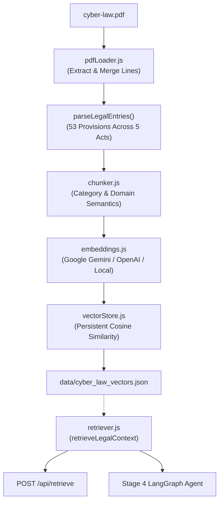

# CyberSahayak — Stage 3: RAG Knowledge Base & PDF Retrieval Engine

This directory contains **Stage 3** of the CyberSahayak platform, featuring an isolated, repeatable Retrieval-Augmented Generation (RAG) architecture built around `cyber-law.pdf`.

---

## 📁 Stage 3 Architecture Overview

```
stage3/
├── cyber-law.pdf                  # Primary legal knowledge base (2 pages, 53 provisions)
├── data/
│   └── cyber_law_vectors.json     # Pre-computed persistent vector database (JSON)
├── lib/
│   └── rag/
│       ├── pdfLoader.js           # Multi-line PDF extractor & statutory parser
│       ├── chunker.js             # Semantic chunking & domain category mapping
│       ├── embeddings.js          # Multi-provider embedding engine (Google, OpenAI, Local)
│       ├── vectorStore.js         # Persistent LangChain-compatible VectorStore
│       └── retriever.js           # Query retriever & prompt context formatter
├── scripts/
│   ├── ingest.js                  # Standalone repeatable ingestion CLI script
│   └── test-retrieval.js          # Semantic retrieval verification test suite
├── app/
│   ├── api/
│   │   └── retrieve/
│   │       └── route.js           # Route Handler: POST /api/retrieve
│   ├── globals.css
│   ├── layout.js
│   └── page.js
├── components/                    # ChatGPT-inspired Vanta Black & Blue interface
├── context/                       # Chat & Theme providers
└── package.json                   # Dependencies and scripts
```

---

## 📜 Step 1: Document Inspection Report

- **File**: `cyber-law.pdf`
- **Source**: Authentic statutory reference for Indian Cyber Law.
- **Physical Structure**: 2 Pages, 42,343 bytes, UTF-8 digital text generated via LibreOffice Writer.
- **OCR Requirement**: **Not Required**. The document contains crisp, non-rasterized digital text.
- **Content Summary**:
  - **IT Act, 2000**: 31 sections (Sec. 65, 66, 66A-F, 67, 67A-C, 69, 69A-B, 70-75, 77, 77A-B, 78, 79, 84B-C, 85).
  - **Indian Penal Code (IPC)**: 16 sections (Sec. 292-294, 378, 379, 383, 420, 463, 464, 468, 469, 499, 500, 503, 506, 507, 509).
  - **Copyright Act, 1957**: 4 sections (Sec. 51, 63, 63A, 63B).
  - **Special Acts**: NDPS Act (online drug sales), Arms Act (online weapon sales).

---

## ⚙️ Ingestion & Retrieval Pipeline



### Key Principles:
1. **Separation of Concerns**: Ingestion runs ahead of time via `npm run ingest` or `node scripts/ingest.js`. The server does **not** re-parse or re-embed the PDF on every chat query.
2. **Deterministic Fallback**: If `GEMINI_API_KEY` or `OPENAI_API_KEY` are unset, the system uses a dense 256-dimensional sublinear TF-IDF semantic vectorizer so automated tests run reliably without quota dependencies.
3. **Factual Grounding**: The retriever strictly cites actual sections from `cyber-law.pdf` (e.g. *Sec. 66C IT Act for Identity Theft*, *Sec. 420 IPC for Bogus Websites*, *Sec. 63B for Pirated Software*).

---

## 🚀 Commands

### 1. Run Knowledge Base Ingestion
```bash
npm run ingest
# or
node scripts/ingest.js
```

### 2. Run Retrieval Verification Tests
```bash
npm run test-rag
# or
node scripts/test-retrieval.js
```

### 3. Test HTTP Retrieval Route
```bash
curl -X POST http://localhost:3000/api/retrieve \
  -H "Content-Type: application/json" \
  -d '{"query": "someone created a fake profile with my photos to scam my friends", "topK": 2}'
```
